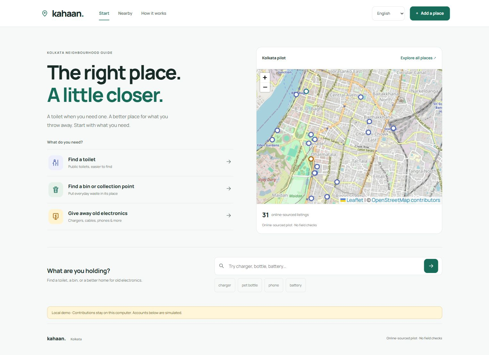
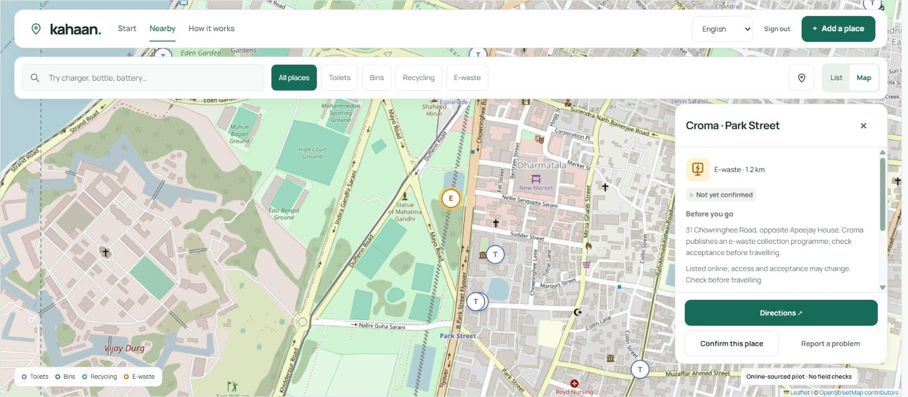
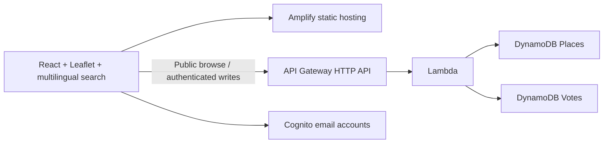

# Kahaan

### Find a toilet. Find a bin. Find the right place for old electronics.

A modern, multilingual neighbourhood guide for **Central Kolkata**. Choose what you need, check the source, and get directions. Help improve the map by adding, confirming or reporting a place.

**[Try the live demo](https://demo.dato5zt1h00lk.amplifyapp.com)** · **[Run locally](#run-locally)** · **[Contribute](CONTRIBUTING.md)** · **[Deploy your own](docs/SETUP.md#deploy-to-your-own-aws-account)**



Built for the **WeMakeDevs x AWS Environmental Hacks 2026**, Waste and Energy track. English by default, with Bengali and Hindi throughout the main flows.

## Why Kahaan?

Finding a facility is only useful if you can understand what it is, where its information came from and whether it suits your need. Kahaan brings sanitation and waste wayfinding together in one focused pilot, with transparent source evidence and community checks.

- **Start with a need:** toilets, everyday waste or old electronics. No account required to browse.
- **Search what you are holding:** 30 items, typo-tolerant search and aliases in all three languages.
- **Choose a suitable place:** map-first Nearby with nearest-first results, item-specific acceptance, source links and clearly labelled distance origin.
- **Contribute:** add a pin, confirm a listing or report a problem after signing in.
- **Understand the evidence:** source data starts with zero votes. Community confirmation does not establish regulatory authorisation.

Start, Nearby and How it works are separate views. Search/filter URLs survive refresh and browser navigation. Location permission is optional; without it, distance is measured from the pilot centre. No runtime AI calls are used.



## Run locally

**Requirements:** Git and **Node.js 24+** with npm. No AWS account, API key or environment file is needed.

```sh
git clone https://github.com/sayan365/kahaan.git
cd kahaan
npm ci
npm run dev
```

Open **http://127.0.0.1:5173**. This starts the frontend and a loopback-only local API. Ctrl+C stops both.

The complete source catalogue ships with the repository. Local contributions persist in ignored `.local-data/state.json`. On restart, newer source records are merged automatically and source metadata is refreshed; existing contributions, votes and counters are preserved. An invalid state file fails visibly rather than being silently reset.

The local banner and sign-in chooser identify **Asha, Rahul and Mira as simulated contributors**. To evaluate the trust flow, add a clearly labelled test place as Asha, then confirm it as Rahul and Mira. The creator cannot vote; duplicate votes are rejected. These accounts do not authenticate against AWS. Keep this local API on loopback.

Internet is required for map tiles and external directions. The location/item catalogue and local contribution API do not depend on the hosted demo. If you already configured `VITE_API_URL`, unset it to use local simulation. See [setup and troubleshooting](docs/SETUP.md).

## What data is included?

The current pilot contains **31 online-sourced listings**, bounded by [`data/area.json`](data/area.json).

| Category | Listings | What to expect |
|---|---:|---|
| Toilets | 26 | OSM records; separate facilities can share a building. Current access is not field-verified. |
| Bins / waste points | 2 | One small-litter bin and one browse-only disposal container. Not household or hazardous-waste destinations. |
| E-waste | 2 | Croma Park Street plus a call-first KMC garage candidate. Item acceptance still needs checking before travel. |
| Recycling | 1 | A call-first service office; walk-in drop-off is not evidenced. |

**Limited coverage is visible, not filled with invented facilities.** Recycling listings are browsable, but an item search may have no suitable destination. Batteries and specialist waste intentionally have no automatic destination until acceptance is evidenced. Choosing a category clears item search and shows its full catalogue, so an earlier charger query cannot hide the bins or recycling listings.

All records were researched online. There are no field checks, measured disposal outcomes or manufactured confirmations. Missing listings do not mean services are absent. [Research notes and sources](data/RESEARCH.md) describe the evidence and gaps; [contributing](CONTRIBUTING.md) explains how to improve coverage.

## How it works



AWS hosts the public app and protects contributions with Cognito. DynamoDB transactions insert a unique vote and increment its counter atomically. Two independent confirmations produce **Community confirmed** only when confirmations exceed reports; two reports produce **Reported** when reports equal or exceed confirmations. Reported and unsuitable points are excluded from automatic recommendations. Creator identity is omitted from public responses.

Local development runs the same validation/service rules against a persistent local store, with explicitly simulated authentication. A public deployment must use the AWS backend, never the local demo server.

## Develop and verify

```sh
npm test
npm run typecheck
npm run build
```

The build outputs `frontend/dist`; tests/build/dev synchronise generated backend data. Edit the authoritative source files, not generated copies. Tests cover trust thresholds, coordinate/input validation, permissions, voting transactions, multilingual search, seed integrity, navigation and local catalogue upgrades.

| Directory | Purpose |
|---|---|
| `frontend/` | Responsive React interface, translations, item catalogue and font assets |
| `backend/` | Local API, AWS handlers, service/domain logic and tests |
| `data/` | Pilot boundary, source places, provenance and research notes |
| `scripts/` | Development, data sync/research, seeding, packaging and shutdown |
| `docs/` | Setup, deployment, cost controls, evidence and submission guidance |

[Setup / deployment](docs/SETUP.md) · [Costs / shutdown](docs/AWS-DEMO.md) · [Verification evidence](docs/VERIFICATION.md) · [Design review](docs/UX-POLISH.md) · [Submission checklist](docs/SUBMISSION.md)

The hosted demo may be retired after judging; local setup remains usable. Deploying to your own AWS account can incur charges. Use your own public configuration identifiers, preserve secrets in ignored env files, and follow the cost/shutdown guide. A frontend build does not replace SAM validation or live AWS acceptance.

## Limits and next steps

This is one bounded pilot with a full-dataset fetch and a simple trust model. No moderation, pickup booking, offline mode or protection against multiple genuine accounts is claimed. Opening hours, public access and collection acceptance can change. Native-language review, physical-device testing and successful independent cloud voting remain outstanding; locally simulated checks are documented separately. Contributed text and map labels stay in their original language.

The most useful next contributions are evidenced public bins, acceptance-specific recycling locations, translation review and moderation. Please include source URLs and uncertainty rather than assuming that a business address is a drop-off point.

## Licence and attribution

Application code and project-authored documentation: **[MIT](LICENSE)**. OpenStreetMap-derived data: **[ODbL](https://www.openstreetmap.org/copyright)**, copyright OpenStreetMap contributors. Operator/municipal records retain their original provenance and applicable rights; the code licence does not relicense them. Manrope: **[SIL Open Font License](frontend/public/fonts/OFL-Manrope.txt)**. Keep map attribution visible and follow the [OSM tile usage policy](https://operations.osmfoundation.org/policies/tiles/).

Codex assisted development, research and interface refinement. Verification and data limitations are reported explicitly.
