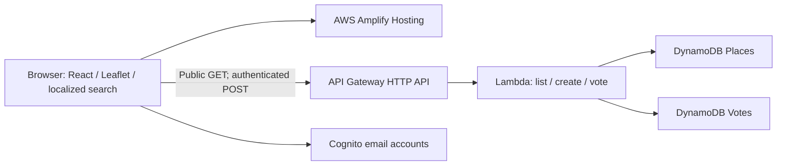

# Kahaan

Find a toilet, a bin or the right place for old electronics in Kolkata. English is the default; Bengali and Hindi are supported across browsing, search, forms and feedback. Anyone can browse. Accounts are required to add, confirm or report a place.

Try the [temporary AWS demo](https://demo.dato5zt1h00lk.amplifyapp.com), or run the application locally using the commands below. The hosted demo may be retired after judging; local development uses the committed source data and does not depend on that deployment or an AWS account. Internet access is needed for map tiles and external directions.

[Setup and troubleshooting](docs/SETUP.md) · [Contributing](CONTRIBUTING.md) · [Verification evidence](VERIFICATION.md) · [Costs and shutdown](AWS-DEMO.md) · [Submission checklist](SUBMISSION.md)

## Run locally

Requires Node.js 22.16+ (Node 24 was used for this build).

```powershell
git clone https://github.com/sayan365/kahaan.git
cd kahaan
npm ci
npm test
npm run build
npm run dev
```

Open http://127.0.0.1:5173. The development API runs on loopback port 3001. The app explicitly labels local demo mode. Asha, Rahul and Mira are simulated contributors; the local server issues temporary session tokens. Places/votes persist under ignored `.local-data/state.json`. These identities do not authenticate against AWS. Do not expose the local demo API publicly.

For a repeatable contribution demo: add a clearly named demo place as Asha, sign out, then confirm as Rahul and Mira. The creator cannot vote, an account cannot vote twice, and two independent confirmations change the label to Community confirmed. Two reports mark it Reported only when reports equal or exceed confirmations. Source records begin with zero votes.

## What is implemented

- Need-based home, nearest-first list, map and type filters.
- Thirty items with English/Bengali/Hindi names, aliases and disposal tips. Fuse.js handles typos. Batteries and mercury-bearing lamps have no automatic destination until specialist acceptance is evidenced.
- Item-specific destination selection with preference order, straight-line distance and external directions. Reported or explicitly unsuitable points are excluded from recommendations.
- Location permission is optional. Distances otherwise use the clearly labelled area centre.
- Add by map pin, coordinates or location; confirm and report; validated authenticated writes.
- Cognito email registration, verification, sign-in and sign-out when configured. Custom localized forms use Amplify Auth.
- Lambda handlers, DynamoDB transactional voting, SAM infrastructure, Amplify build specification and idempotent seed script.

## Online data and provenance

The pilot window is in `data/area.json`; it is not an administrative boundary or citywide coverage. Initial data includes **18 OpenStreetMap toilet candidates** and **one operator-published Croma collection point**. Public bins/recycling searches returned no records; those categories show empty states rather than fabricated places. Data gaps do not prove facilities are absent.

Each source-backed place links its source. `data/sources.json` records methods, dates and limitations. Croma's [programme](https://www.croma.com/lp-croma-e-waste) and [Park Street store page](https://store.croma.com/croma-park-street-electronics-retail-and-repair-shop-park-street-area-kolkata-263521/Home) provide collection policy and location. Item-specific acceptance is not guaranteed; users are told to check before travel. KMC's historical 2015 toilet list was not presented as current verified data.

Overpass returned errors during research, so a bounded, rate-limited Nominatim search supplied the initial OSM snapshot. `npm run fetch:osm` tries Overpass again when needed. `node scripts/research-osm.mjs` is a one-off fallback, not a runtime API; do not run it repeatedly or use it as a bulk crawler. `node scripts/sync-data.mjs` copies authoritative area/seed files into runtime locations. Repeat seeding never overwrites existing votes.

Map tiles and facility data: © [OpenStreetMap contributors](https://www.openstreetmap.org/copyright), data licensed under ODbL. Keep attribution visible. External tiles require connectivity and follow the [OSM tile usage policy](https://operations.osmfoundation.org/policies/tiles/). Do not prefetch tiles or claim offline support.

## AWS deployment

Live demo: **https://demo.dato5zt1h00lk.amplifyapp.com**. The backend was deployed through CloudFormation in Mumbai and seeded with 19 sourced locations. Public GET, CORS, unauthenticated write rejection, live sign-in, authenticated creation and creator-vote rejection have been checked. Independent cloud voting still needs acceptance testing with another account. See [AWS-DEMO.md](AWS-DEMO.md) for budget limits, resource inventory and shutdown instructions. AWS CLI and SAM CLI are **not installed in the local build environment**. For a separate CLI deployment, install the official [AWS CLI](https://docs.aws.amazon.com/cli/latest/userguide/getting-started-install.html) and [SAM CLI](https://docs.aws.amazon.com/serverless-application-model/latest/developerguide/install-sam-cli.html), then authenticate with your own account locally. Never paste credentials into chat or commit them.

1. Set an AWS budget alert. Authenticate locally (for example `aws configure sso`, then `aws sso login --profile your-profile`). Export `AWS_PROFILE` if using a named profile.
2. Push this project to a public repository, preserving real hackathon development history and third-party attribution. Connect the repository in AWS Amplify Hosting, selecting the `frontend` app root and the tracked `amplify.yml`. Obtain its exact HTTPS origin.
3. Validate and deploy from the project root:

```powershell
node scripts/sync-data.mjs
sam validate --lint
sam build
sam deploy --guided --region ap-south-1 --parameter-overrides FrontendOrigin=https://YOUR-AMPLIFY-DOMAIN
```

4. Read the outputs: ApiUrl, PlacesTable, UserPoolId and UserPoolClientId. Set Amplify build environment variables:

```text
VITE_API_URL=<ApiUrl>
VITE_AWS_REGION=ap-south-1
VITE_USER_POOL_ID=<UserPoolId>
VITE_USER_POOL_CLIENT_ID=<UserPoolClientId>
```

5. Seed the live table using your local authenticated AWS session:

```powershell
$env:AWS_REGION = 'ap-south-1'
$env:PLACES_TABLE = '<PlacesTable>'
npm run seed
```

6. Redeploy Amplify after setting the variables. For local testing against AWS, copy `frontend/.env.example` to `frontend/.env`, fill the same public identifiers, and restart Vite. Missing production configuration shows a setup error; production never switches to demo authentication.
7. Verify the live `/places`, Cognito email verification, unauthorized write rejection, creator/duplicate-vote rejection, independent confirmation, CORS and mobile HTTPS behaviour. Create three real demo accounts ahead of recording. Do not label the local simulation as an AWS deployment.

The API Gateway JWT authorizer validates Cognito issuer/audience. The client sends the ID token; this configuration does not require OAuth scopes. Live token acceptance passed authenticated creation and creator-vote rejection; independent cloud voting still needs testing. Only GET /places is public. API Gateway limits requests to a 5 req/s rate and 10 burst for the short demo. DynamoDB tables use on-demand capacity and stack-managed Lambda logs expire after seven days. Costs depend on usage and account eligibility; throttling is not a spending cap. See [AWS-DEMO.md](AWS-DEMO.md) for the current account blocker, budget status, artifact packaging, pause and permanent shutdown instructions.

## Architecture



AWS is used for actual hosting, authenticated contributions and atomic community voting; no AI inference is needed. A DynamoDB transaction inserts the unique vote and increments its counter together. Derived status is never stored. API responses omit creator identity.

## Verification commands

`npm test` covers status branches, geography, malformed input, permission rules, independent votes, duplicate votes, multilingual/typo search and seed integrity. `npm run typecheck` checks the frontend; `npm run build` produces `frontend/dist`. The build is not a substitute for `sam validate` or live AWS acceptance.

## Hackathon demo (under three minutes)

0:00–0:20: a person needs a toilet or has an old charger in Kolkata.
0:20–1:15: choose a need, find a sourced place, search charger and open directions; switch Bengali/Hindi without losing the task.
1:15–2:10: add a place, demonstrate creator/duplicate rejection and two other accounts confirming it.
2:10–2:35: show the actual AWS deployment and explain atomic votes.
2:35–2:45: explain coverage gaps and next steps.

Use the AWS URL and real accounts for the final video once deployed. Submission requires a public repository, a YouTube video under three minutes, and a short writeup. Check the [event schedule](https://www.wemakedevs.org/aws/env/schedule) for the precise deadline.

## Known limits

Single area and full-dataset fetch; no moderation or protection against someone creating multiple genuine accounts. Community confirmation does not establish regulatory authorisation or current accessibility. All locations were researched online; no field checks, human usability study or actual disposal outcomes were measured. Translation and tips need local/native review before broader release. Basemap labels and contributed names/notes remain in the source language. Collection acceptance, fees and current conditions may change. No photos, pickup bookings, offline mode, rewards or invented environmental impact statistics.

Before scaling: moderation, contributor abuse controls, acceptance-specific facility data, more locally reviewed translations, and geographic indexing. Those are future work, not features claimed in this submission.
